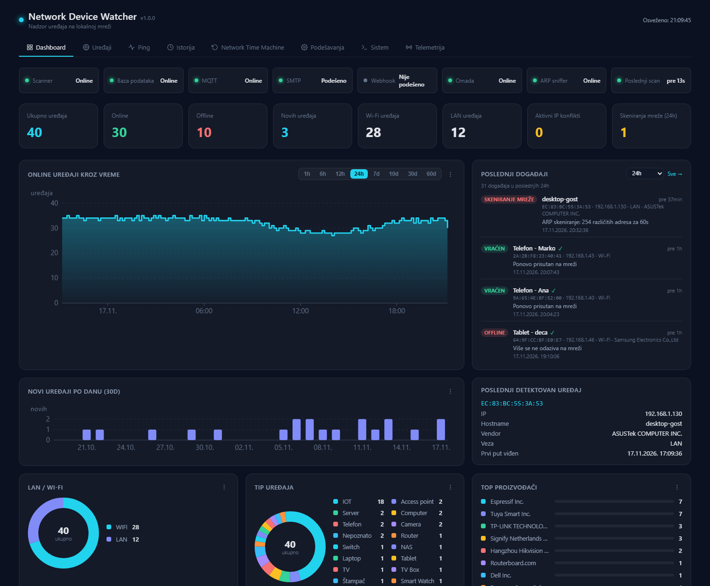
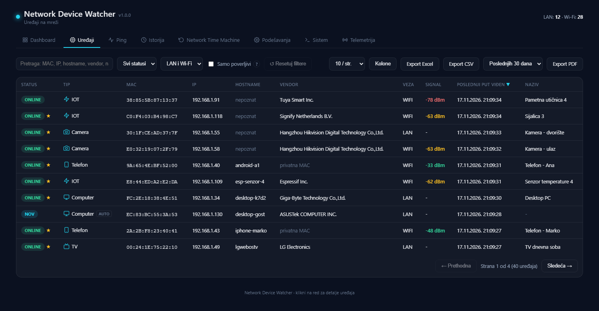
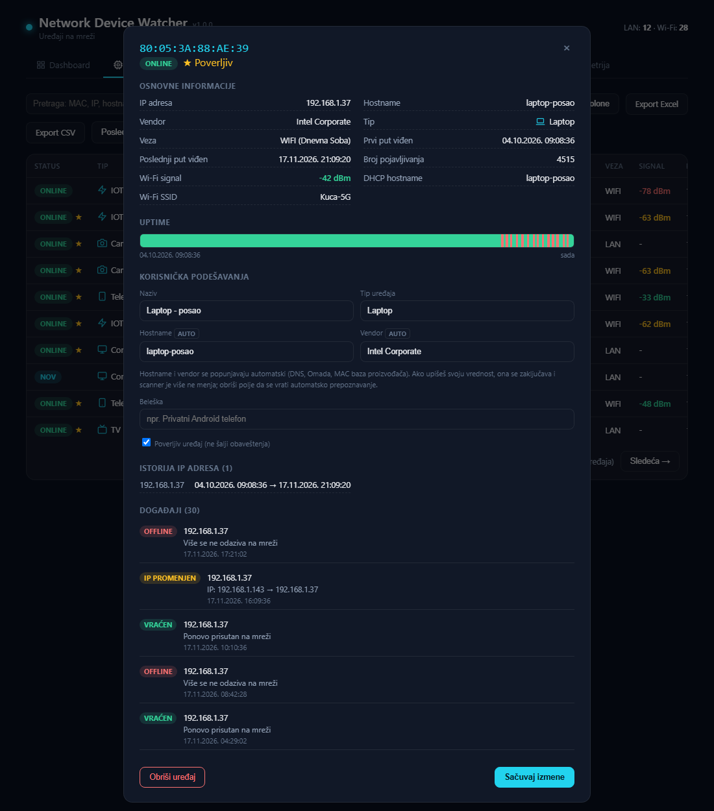
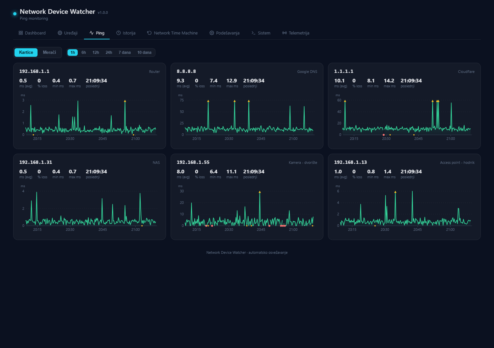
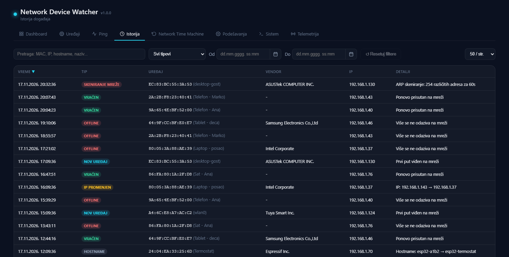
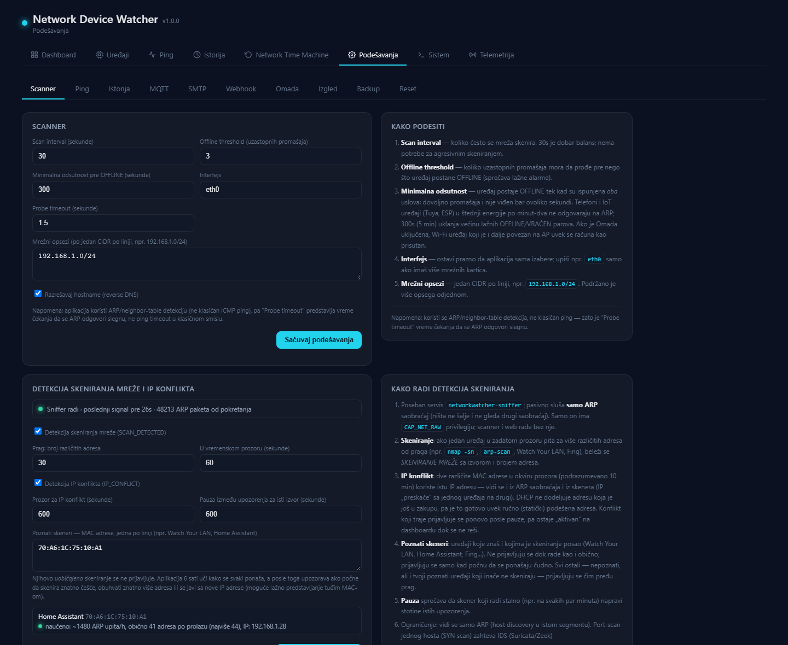

# NDW — Network Device Watcher

  

A self-hosted web application that automatically discovers, records and monitors every device on your local network (LAN and Wi-Fi), tells you the moment something **new** shows up, and pushes events to **Home Assistant (MQTT)**, **e-mail (SMTP)** and **webhooks**.

It is designed to run in a small **Proxmox LXC container** (Debian), uses minimal privileges, and needs no user accounts — it is meant for a trusted LAN.

> The web interface is in **Serbian** (Latin script). The code, API and this documentation are in English.



---

## Features

**Discovery & detection**
- Periodic ARP / neighbor-table discovery of every host in one or more configured subnets — runs fully unprivileged.
- The **MAC address is the device identity**; IP changes (DHCP) are tracked as history, never as duplicates.
- Device states **NEW / ONLINE / OFFLINE / RETURNED** with debounce: a device goes offline only after N missed scans **and** a minimum absence time, which removes false alarms from phones and IoT devices in Wi-Fi power-save mode.
- Vendor lookup from an automatically refreshed (weekly) IEEE/Wireshark OUI database; "private MAC" detection for randomized phone addresses.
- **Automatic device type** (phone, laptop, TV, camera, IoT, server, NAS, router, AP, …) with icons — never overrides a type you set yourself.
- Manual override of name, hostname, vendor and type for devices that cannot be identified automatically.

**Security anomalies**
- **Network scan detection** — a small, separate, read-only ARP listener spots hosts sweeping the subnet (`nmap -sn`, `arp-scan`, …).
- **Known scanners** (e.g. a monitoring tool or Home Assistant) are learned over 6 hours and only reported when they behave unusually: much higher scan rate, more targets than usual, or appearing from a new IP address (possible MAC spoofing).
- **IP conflict detection** — the same IP used by two different MAC addresses, seen both from ARP traffic and from scans.
- Burst of new devices, and device fingerprint changes (via TP-Link Omada).

**Notifications**
- MQTT with **Home Assistant MQTT Discovery** (sensors for totals, online, Wi-Fi/LAN, last new device, binary sensor for new devices).
- SMTP e-mail and generic HTTP webhooks (n8n, Node-RED, Discord, Telegram bridges, …).
- **Quiet hours** (time-zone aware) and **trusted devices** suppress routine notifications; security anomalies are still reported.
- Every notification attempt is logged (sent / failed / skipped with reason) and visible in the UI.
- Real-time toasts in the browser via WebSocket.

**Web interface**
- Dashboard with status strip, stat cards and charts (online devices over time with 1 h – 60 days range, new devices per day, LAN/Wi-Fi split, device types, top vendors) — selectable chart style and colors.
- Device table with sorting on every column, filters, search, column picker, device detail panel with uptime bar, IP history and events.
- Event history, **Network Time Machine** (reconstruct which devices were online at any past moment and diff against now).
- **Ping monitoring** of any targets (LAN or internet) with RTT charts (1 h – 10 days), packet loss, color bands and an alternative "meters" view.
- System logs of all services, notification log, host telemetry (CPU, RAM, disk, network).
- Export to **Excel**, **CSV** and **PDF** report.
- Themes (dark, light, blue, green, purple, high contrast, custom), glass/transparent cards, custom background image with opacity/blur/brightness controls.

**Integrations**
- **TP-Link Omada** controller (Open API): real Wi-Fi SSID, RSSI and access point for wireless clients, switch port for wired clients, DHCP hostnames, presence of sleeping Wi-Fi clients.

## Screenshots

| Devices | Device detail |
|---|---|
|  |  |

| Ping monitoring | Event history |
|---|---|
|  |  |



*Screenshots are generated from synthetic demo data (see [Demo server](#demo-server)).*

## Architecture

```text
 LAN / Wi-Fi ──► networkwatcher-scanner  ── ARP/neighbor scan, detection engine, Omada sync,
                                            MQTT/SMTP/webhook notifications
             ──► networkwatcher-sniffer  ── passive ARP listener: scan & IP-conflict detection
                                            (the only service with CAP_NET_RAW)
                 networkwatcher-pinger   ── ping monitoring (setcap on the ping binary only)
                 networkwatcher-worker   ── retention cleanup, weekly vendor database refresh
                 networkwatcher-web      ── FastAPI REST API + WebSocket + static web UI
                            │
                            ▼
                       PostgreSQL
```

Stack: Python 3.11+, FastAPI, SQLAlchemy 2, Alembic, PostgreSQL, Eclipse Paho MQTT, openpyxl, ReportLab, vanilla HTML/CSS/JS (no build step).

## Installation (Debian 12/13, e.g. a Proxmox LXC)

Recommended container: 2 vCPU, 1–2 GB RAM, 8–20 GB disk, bridged network, static IP or DHCP reservation.

```bash
# 1. System packages
apt update
apt install -y python3 python3-venv python3-pip postgresql iproute2 iputils-ping libcap2-bin git

# 2. Service user and code
useradd --system --home /opt/networkwatcher --shell /usr/sbin/nologin networkwatcher
usermod -aG systemd-journal networkwatcher        # lets "Sistem -> Logovi" read service logs
git clone https://github.com/zoomtronicOR/NDW---Network-device-watcher.git /opt/networkwatcher
cd /opt/networkwatcher
python3 -m venv venv
./venv/bin/pip install -r requirements.txt

# 3. Database -- must be UTF8 (device names may contain non-ASCII characters)
sudo -u postgres psql -c "CREATE ROLE networkwatcher LOGIN PASSWORD 'choose-a-password';"
sudo -u postgres psql -c "CREATE DATABASE networkwatcher OWNER networkwatcher ENCODING 'UTF8' LC_COLLATE 'C.UTF-8' LC_CTYPE 'C.UTF-8' TEMPLATE template0;"

# 4. Configuration
cp .env.example .env          # set DATABASE_URL password and a long random SECRET_KEY
chmod 600 .env
./venv/bin/alembic upgrade head

# 5. Privileges: ping monitoring needs raw sockets only for the ping binary
setcap cap_net_raw+ep "$(command -v ping)"     # re-run after iputils-ping upgrades

# 6. Services
chown -R networkwatcher:networkwatcher /opt/networkwatcher
cp deploy/systemd/*.service /etc/systemd/system/
systemctl daemon-reload
systemctl enable --now networkwatcher-web networkwatcher-scanner networkwatcher-pinger \
                       networkwatcher-worker networkwatcher-sniffer
```

Open `http://<container-ip>:8080`, go to **Podešavanja → Scanner**, set your network range(s) (e.g. `192.168.1.0/24`) and the interface. Everything else (MQTT, SMTP, webhook, Omada, quiet hours, themes, retention) is configured from the web UI and stored in the database; `SECRET_KEY` encrypts stored passwords.

### Upgrading

```bash
cd /opt/networkwatcher
git pull
./venv/bin/pip install -r requirements.txt
./venv/bin/alembic upgrade head
systemctl restart networkwatcher-web networkwatcher-scanner networkwatcher-pinger networkwatcher-worker networkwatcher-sniffer
```

## Security notes

- There is **no login** by design. Expose the UI only on a trusted LAN/VLAN, or put it behind a reverse proxy with authentication, a VPN or Tailscale.
- Least privilege: the web, scanner and worker services run as an unprivileged user without capabilities. Only `networkwatcher-sniffer` receives `CAP_NET_RAW` (via its systemd unit) to read ARP frames — it never sends packets. Ping uses a file capability on the `ping` binary only.
- SMTP/MQTT/Omada secrets are stored encrypted and are never sent back to the browser.

## MQTT topics

With base topic `networkwatcher` (configurable):

```text
networkwatcher/status                       online / offline (LWT)
networkwatcher/devices                      JSON snapshot of all devices
networkwatcher/stats/<name>                 total, online, wifi, lan, last_new_device, new_device_flag
networkwatcher/device/<aa_bb_cc_dd_ee_ff>/status   online / offline
networkwatcher/device/<aa_bb_cc_dd_ee_ff>/ip
networkwatcher/events/new_device | offline | returned | scan_detected | ip_conflict
```

Home Assistant MQTT Discovery can be enabled in **Podešavanja → MQTT**.

## REST API

Interactive OpenAPI docs are served at `/docs`. Main endpoints:

```text
GET  /api/devices            GET/PATCH/DELETE /api/devices/{id}
GET  /api/events             GET  /api/stats            GET /api/version
GET  /api/charts/...         GET  /api/ping/series      GET /api/notifications
GET/PUT /api/settings/{scanner|mqtt|smtp|webhook|omada|history|notifications|scan-detection|appearance|ping}
POST /api/test/{mqtt|smtp|webhook|omada}
GET  /api/export/{excel|csv|pdf}
WS   /api/ws
```

## Demo server

`tools/mock_server.py` serves the real web UI with a fake, synthetic API (standard library only, no database, no scanning). It is used to produce the screenshots above:

```bash
python tools/mock_server.py      # http://127.0.0.1:8765
```

## Versioning

The project follows [Semantic Versioning](https://semver.org). The current version is defined in `app/version.py`, shown next to the title in the UI and returned by `GET /api/version`. See [CHANGELOG.md](CHANGELOG.md) for the release history.

## License

[MIT](LICENSE) © 2026 Zoran Nikolić
